> [!NOTE]
> Esto es un mod extensión para [Town of Us: Mira](https://github.com/AU-Avengers/TOU-Mira) que añade nuevos roles.\
> Este mod requiere que Town of Us: Mira esté instalado para funcionar perfectamente.

  <a href="#">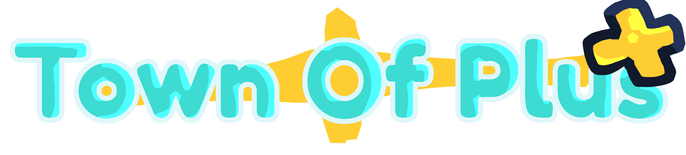</a>
  
Un mod innecesariamente necesario

 

Mod de [Among Us](https://store.steampowered.com/app/945360/Among_Us/) que añade bastantes
nuevos roles para [Town Of Us – Mira](https://github.com/AU-Avengers/TOU-Mira).

ÚNETE A DUESTRO DISCORD:
[Link](https://discord.gg/39b4CT9jsa)

  
  
  <a href="#">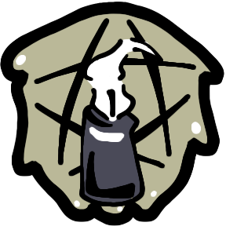</a>
  
  <a href="#">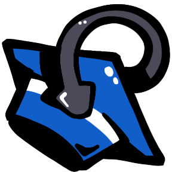</a>
  <a href="#">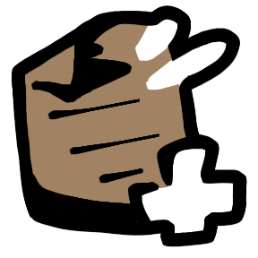</a>
  
  <a href="#">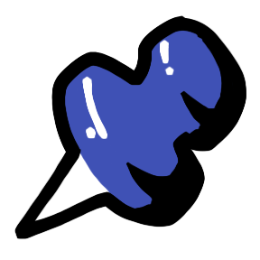</a>
  
  
  
  <a href="#">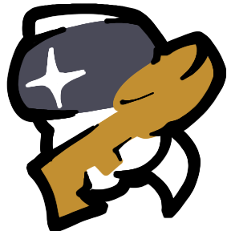</a>
  
  <a href="#">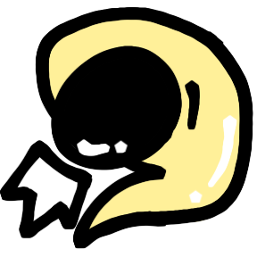</a>
  
  
  
  <a href="#">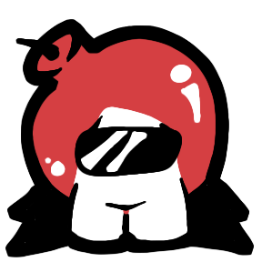</a>
  
  <a href="#">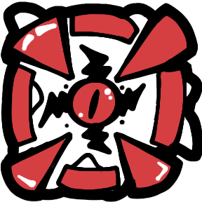</a>
  
  <a href="#">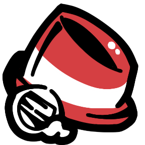</a>
  
  <a href="#">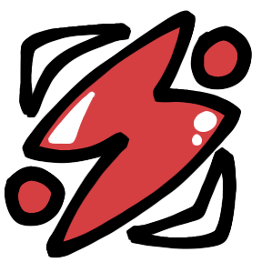</a>
  
  

## Instalación

1. Instala el mod usando el mismo proceso de configuración que Town Of Us Mira.
2. Una vez instalado Town Of Us Mira, coloca `TownOfPlus.dll` en la carpeta `[MODFOLDER]/BepInEx/plugins/`.
3. Inicia Among Us. Todas las opciones de Town Of Plus aparecerán en la pestaña **Town Of Plus** en las opciones del vestíbulo.

## Roles

### Tripulante Poder

**Profesor** — Reentrena tripulantes para cambiarles el rol  
Completa tareas para ganar cargas de reentrenar. En reunión marca a un tripulante (o a ti mismo). Al finalizar podrá cambiar de rol entre 3 opciones.

**Deudor** — Haz tratos y cobra favores  
Marca jugadores vivos con Trato. Si uno de ellos usa una habilidad, te deberá un favor y su voto irá a donde vaya el tuyo. Las deudas se limpian tras cada reunión.

### Tripulante Soporte

**Colega** — Acompaña y protege a un jugador  
Marca a un jugador vivo con Acompañar. Siempre verás una flecha hacia él. Si usa una habilidad, la flecha se oculta 3 segundos. Si muere, tu voto cuenta doble. En reunión, Esperanza intercambia todos los votos entre tú y tu acompañado.

**Víctima** — Guarda notas secretas que se revelan al morir  
Puedes escribir notas que duran hasta la siguiente reunión. Solo cuando te maten tus notas serán reveladas.

**Aislador** — Aísla a otros con burbujas  
Marca jugadores con Soplar y enciérralos a todos con Burbuja: quedan unos segundos sin moverse ni usar habilidades. También puedes protegerte con Escudo: una burbuja que te hace inmune a asesinatos.

### Tripulante Investigativo

**Ermitano** — Escapa al punto que marques con el cursor  
Abre un canal de Escape sobre tu cursor. Haz clic donde puedas y teletranspórtate al punto del cursor volviéndote invisible unos segundos.

**Ritualista** — Marca objetivos y sacrifica a los malos  
Marca una cantidad de jugadores establecidos y en una reunión te serán reveladas sus facciones. Aprovecha esa información y mata a los traidores.

### Tripulante del Más Allá

**Cerrajero** — Abre y cierra puertas desde el más allá  
Aprovecha tu habilidad de cerrar y abrir puertas para ayudar a la tripulación o dificultar a los traidores.

**Huésped** — Posee a un jugador vivo desde el más allá  
Aprovecha tu estado fantasmal para tomar el control de un jugador durante unos segundos y alejarlo del peligro.

**Eco** — Espíritu con ancla  
Tienes un ancla (jugador vivo asignado) a la que estas atada. pueden comunicarse mutuamente pero el ANCLA puede ser adivinado

### Impostor Soporte

**Abogado** — Chantajea jugadores y termina reuniones  
Chantajea a 1 jugador: vote a quien vote, su voto se redirige a omitir. En reunión fuerza omitir de TODOS. Disponible en la 1ª reunión y luego cada ciertas reuniones.

### Impostor Ocultamiento

**Kamikaze** — Engaña con tu ciclo de habilidades y detona al ser expulsado  
Tu misión es ser expulsado para poder ganar. No puedes matar, pero puedes intentar engañar a la tripulación con un ciclo de 4 habilidades.

### Impostor Asesino

**Francotirador** — Recarga tu rifle y elimina desde la lejanía  
Espera a recargar. Luego siéntete libre de matar a la distancia. Pero cuidado con que escuchen tus disparos.

### Impostor Poder

**Dictador** — Revélate y redirige votos como el Alcalde  
Empieza como un impostor normal. En cada reunión acumula los votos EN CONTRA. Al alcanzar el umbral puede REVELARSE en reunión con la animación del Alcalde. Ya revelado, redirige como máximo 2 votos ajenos hacia el jugador que él votó.

### Impostor Más Allá

**Saboteador** — Apaga las luces desde el más allá  
Puedes sabotear electricidad durante unos segundos. Incluso si tus aliados ya saboteó otra cosa.

### Neutral del Más Allá

**Amalgama** — Resucita en un cuerpo con un rol nuevo  
Tienes una segunda oportunidad de volver a la vida. Pero tu destino es incierto: ayudar a tu tripulación o masacrar a tus propios compañeros.

## Releases

**Descargo de responsabilidad: el mod *no* está garantizado para funcionar en las últimas versiones de Among Us cuando el juego se actualiza.**

| Versión del juego | Versión del mod | Town Of Us: Mira | Enlace de descarga |
| ------------ | ----------- | ---------------- | ------------- |
| 19.0 | 1.0.8 | [v1.0.7-beta1](https://github.com/D4MaNI69/Town-Of-Plus-/releases/tag/top) |

---

## Contribuciones y Créditos

[MiraAPI](https://github.com/All-Of-Us-Mods/MiraAPI): Marco y API del mod\
[Town Of Us: Mira](https://github.com/AU-Avengers/TOU-Mira): Mod base, inspiración y recursos compartidos\
[Reactor](https://github.com/NuclearPowered/Reactor): Redes y dependencia de compilación\
[BepInEx](https://github.com/BepInEx/BepInEx): Cargador de plugins IL2CPP y ganchos de Harmony

## Ideas de nuestra comunidad DISCORD

Sin ideas...

## Inspiraciones

Sin inspiraciones aún...
