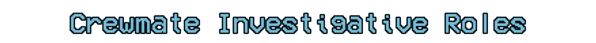
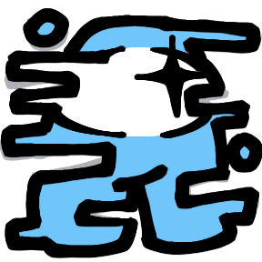
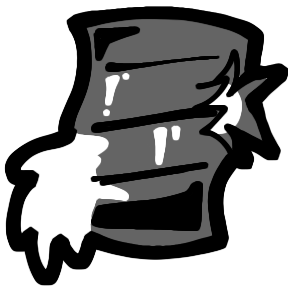
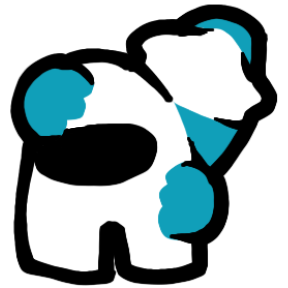
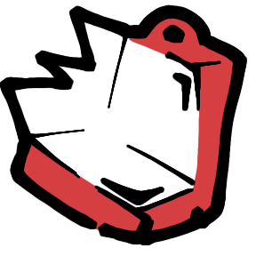
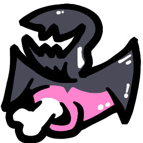

> [!NOTE]
> This repo is an extension mod for [Town of Us: Mira](https://github.com/AU-Avengers/TOU-Mira) that adds new roles and modifiers.\
> This mod requires Town of Us: Mira to be installed and is NOT for console versions of Among Us.

  
  
Town Of Plus

 

An [Among Us](https://store.steampowered.com/app/945360/Among_Us/) mod that adds
new roles and modifiers on top of [Town Of Us &ndash; Mira](https://github.com/AU-Avengers/TOU-Mira).

Join the Discord:
[Link](https://discord.gg/dqzQrcxqdx)

  
  
  
  
  
  
  
  
  
  
  
  
  
  
  
  
  
  
  
  
  
  
  
  
  
  

## Installation

1. Install the mod using the same setup process as Town Of Us Mira.
2. Once Town Of Us Mira is installed, place `TownOfPlus.dll` into the `[MODFOLDER]/BepInEx/plugins/` folder.
3. Launch Among Us. All Town Of Plus options will appear under the **Town Of Plus** tab in the lobby options.

For the simplest install, make sure your Town Of Us Mira installation is working first, then add `TownOfPlus.dll` to the plugins folder.

## Roles

### Crewmate Power

**Profesor** — Reentrena tripulantes para cambiarles el rol  
Completa tareas para ganar cargas de reentrenar. En reunión marca a un tripulante (o a ti mismo). Al terminar podrá cambiar de rol entre 3 opciones.

**Deudor** — Haz tratos y cobra favores  
Marca jugadores vivos con Trato. Si uno de ellos usa una habilidad, te deberá un favor y su voto irá a donde vaya el tuyo. Las deudas se limpian tras cada reunión.

### Crewmate Support

**Colega** — Acompaña y protege a un jugador  
Marca a un jugador vivo con Acompañar. Siempre verás una flecha hacia él. Si usa una habilidad, la flecha se oculta 3 segundos. Si muere, tu voto cuenta doble. En reunión, Esperanza intercambia todos los votos entre tú y tu acompañado.

**Víctima** — Guarda notas secretas que se revelan al morir  
Puedes escribir notas que duran hasta la siguiente reunión. Solo cuando te maten tus notas serán reveladas.

**Aislador** — Aísla a otros con burbujas  
Marca jugadores con Soplar y enciérralos a todos con Burbuja: quedan 3 segundos sin moverse ni usar habilidades. También puedes protegerte con Escudo: una burbuja te sigue y eres inmune a asesinatos.

### Crewmate Investigative

**Ermitaño** — Escapa al punto que marques con el cursor  
Abre un canal de Escape sobre tu cursor. Haz click donde puedas y teletranspórtate al punto del cursor volviéndote invisible unos segundos.

**Ritualista** — Marca objetivos y sacrifica a los malos  
Marca una cantidad de jugadores establecidos y en una reunión te serán reveladas sus facciones. Aprovecha esa información y mata a los traidores.

### Crewmate Afterlife

**Cerrajero** — Abre y cierra puertas desde el más allá  
Aprovecha tu habilidad de cerrar y abrir puertas para ayudar a la tripulación o dificultar a los traidores.

**Huésped** — Posee a un jugador vivo desde el más allá  
Aprovecha tu estado fantasmal para tomar el control de un jugador durante unos segundos y alejarlo del peligro.

**Eco** — Espíritu con ancla  
Se convierte solo si muere dentro de la reunión. Tiene un ancla (jugador vivo asignado) a la que regresa si se aleja demasiado. Solo ve el nombre de su ancla con el color de su rol.

### Neutral Afterlife

**Amalgama** — Resucita en un cuerpo con un rol nuevo  
Tienes una segunda oportunidad de volver a la vida. Pero tu destino es incierto: traicionar a tu tripulación o masacrar a tus propios compañeros.

### Impostor Support

**Abogado** — Chantajea siempre; Terminar cada N reuniones  
Chantajea a 1 jugador: vote a quien vote, su voto se redirige a skip. En reunión (votación): TERMINAR fuerza skip de TODOS. Disponible en la 1ª reunión y luego cada N reuniones.

### Impostor Concealing

**Kamikaze** — Engaña con tu ciclo de habilidades y detona al ser expulsado  
Tu misión es ser expulsado para poder ganar. No puedes matar, pero puedes intentar engañar a la tripulación con un ciclo de 4 habilidades (Transformar, Desvanecer, Excavar, Arrastrar).

### Impostor Killing

**Francotirador** — Recarga tu rifle y elimina desde la lejanía  
Espera a recargar, cuando lo hagas quédate quieto. Luego siéntete libre de matar a la distancia. Pero cuidado con que escuchen tus disparos.

### Impostor Power

**Dictador** — Revelate y redirige votos como el Mayor  
Empieza como un impostor normal. En cada reunión acumula los votos EN CONTRA. Al alcanzar el umbral puede REVELARSE en reunión con la animación del Mayor. Ya revelado, redirige como máximo 2 votos ajenos hacia el jugador que él votó.

### Impostor Afterlife

**Saboteador** — Apaga las luces desde el más allá  
Puedes sabotear electricidad durante unos segundos. Incluso si tus aliados ya sabotearon otra cosa.

## Releases

**Disclaimer: The mod is *not* guaranteed to work on the latest versions of Among Us when the game updates.**

| Game Version | Mod Version | Town Of Us: Mira | Download link |
| ------------ | ----------- | ---------------- | ------------- |
| 17.4 | 1.0.8 | 1.7.1+ | [v1.0.8](https://github.com/d4mani/TownOfPlus/releases/tag/v1.0.8) |
| 17.4 | 1.0.7 | 1.7.0 | [v1.0.7](https://github.com/d4mani/TownOfPlus/releases/tag/v1.0.7) |
| 17.3 (2026.3.31) | 1.0.6 | 1.6.0 - 1.6.2 | [v1.0.6](https://github.com/d4mani/TownOfPlus/releases/tag/v1.0.6) |

---

## Contributions & Credits

[MiraAPI](https://github.com/All-Of-Us-Mods/MiraAPI): Mod framework and API\
[Town Of Us: Mira](https://github.com/AU-Avengers/TOU-Mira): Base mod, inspiration, and shared assets\
[Reactor](https://github.com/NuclearPowered/Reactor): Networking and build dependency\
[BepInEx](https://github.com/BepInEx/BepInEx): IL2CPP plugin loader and Harmony hooks

## Idea box Ideas (Town Of Plus Discord)

- Community suggestions for roles and modifiers

## Source inspiration

Some of my roles and modifiers take design cues from other Among Us mod communities. These pages were useful references:

- **Deudor** - Custom design inspired by vote-redirect mechanics
- **Profesor** - Custom design inspired by role-training mechanics
- **Aislador** - Custom design inspired by bubble/isolation mechanics
